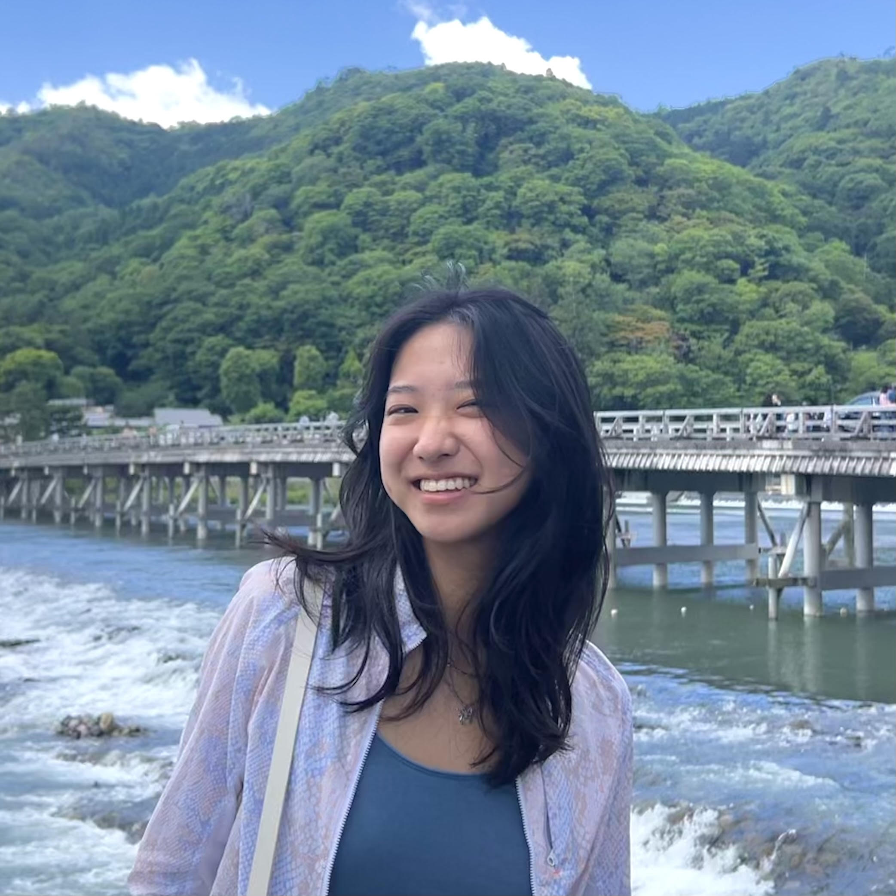

    

        
        

            
Hi, I'm Elaine.

            
I’m a builder and <a href="https://elainexliu.com/posts/improv.html">improviser</a> in San Francisco. I am curious about why people are the way they are, how we got here, and where we’re headed as technology changes the way we live, work, and connect. I make things for people, and I’m happiest when something I made <a href="https://www.sciencefocus.com/comment/joke-brain-find-funny">la</a><a href="https://note.com/kitcut/n/n15b65f13b60a?hl=en">nds</a> and changes how we live for the better.

            
Currently, I’m building at * and playing improv at BATS. I also <a href="https://www.goodreads.com/user/show/164429042-elaine-liu">read</a> and <a href="https://www.instagram.com/eggshellsandoil/">paint</a> a lot. Previously, I built a <a href="https://elainexliu.com/projects/dawn.html">closed-loop device</a> to interrupt compulsive behaviors, studied EECS and political science at MIT, developed medical electronics with the <a href="https://conformabledecoders.media.mit.edu/">Conformable Decoders</a> group and clinical products at <a href="https://www.abbycare.org/">Abby Care</a>, and performed with <a href="https://www.instagram.com/roadkillbuffet/">RKB</a> and at Second City in Chicago.

        

    

<!-- 

    <h2 class="section-title">now</h2>
    <ul class="bullet-list">
        <li>Building and being impatient</li> 
    </ul>

 -->

    <h2 class="section-title">previously</h2>
    <h3 class="experience-category">building things</h3>
    <ul class="bullet-list">
        <li>2025: Product @ Abby Care</li>
        <li>2023-2025: Researcher @ Conformable Decoders</li>
        <li>2023: Deep Learning Researcher (vehicle computer vision model optimization) @ VIA</li>
        <li>2023: Researcher (controlled drug delivery methods + fixtures for bioMEMS research) @ the Koch Institute of Integrative Cancer Research</li>
        <li>2022: EE (fire alarm detection products and IoT data management systems) @ Enventys Partners</li>
        <li>2022: Researcher (hereditary cataract prediction) @ UNC Wilmington</li>
        <li>2021-2022: Built a hardware community for young girls @ sheMakes</li>
        <li> <a href="https://fabacademy.org/2020/labs/charlotte/students/elaine-liu/">How to make almost anything</a> @ FabAcademy</li>
        <li><a href="https://elainexliu.com/projects.html">more things I've built</a></li>
    </ul>
    <h3 class="experience-category">thinking about things</h3>
    <ul class="bullet-list">
        <li>2026: Investment Intern @ Neo</li>
        <li>2024: Strategy and investing for deep tech, health, and consumer @ Thrive Capital</li>
        <li>2023: Schemed with Cohort 2 Admin @ Prod</li>
    </ul>

